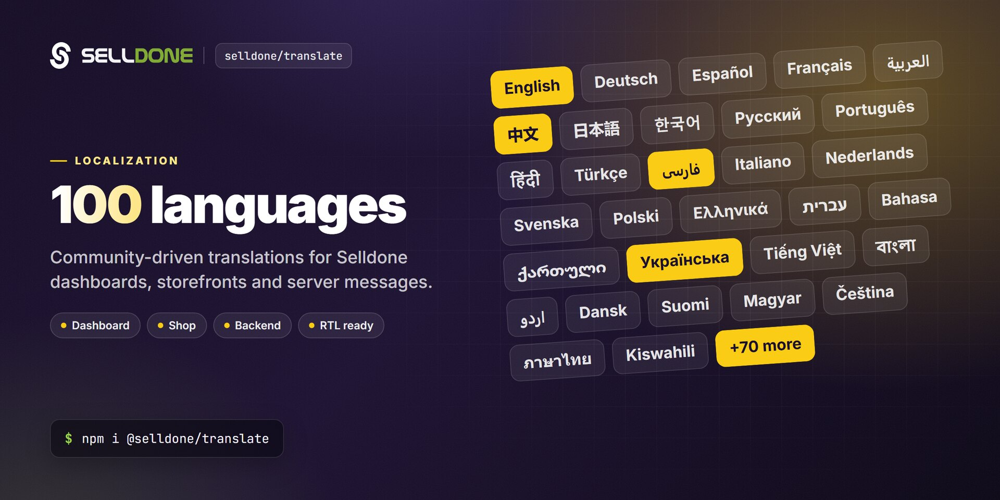

<p align="center">
  
</p>

<p align="center">
  <a href="https://www.npmjs.com/package/@selldone/translate"></a>
  <a href="https://www.npmjs.com/package/@selldone/translate"></a>
  <a href="LICENSE"></a>
  <a href="https://github.com/selldone/translate/wiki"></a>
  <a href="https://selldone.com"></a>
</p>

<p align="center">
  <b>Community-maintained translation files for the Selldone dashboard, storefronts and backend messages, in about 100 languages.</b><br>
  <a href="https://github.com/selldone/translate/wiki">Documentation</a> ·
  <a href="#quick-start">Quick start</a> ·
  <a href="#how-to-submit-a-change">Submit a correction</a> ·
  <a href="https://github.com/selldone">Ecosystem</a> ·
  <a href="https://selldone.com">Selldone.com</a> ·
  <a href="https://github.com/selldone/translate/issues">Report an issue</a>
</p>

<p align="center">
  <a href="https://github.com/selldone/storefront">Storefront</a> ·
  <a href="https://github.com/selldone/pagebuilder">Page Builder</a> ·
  <a href="https://github.com/selldone/components">Components</a> ·
  <a href="https://github.com/selldone/storefront-sdk">Storefront SDK</a> ·
  <a href="https://github.com/selldone/backoffice-sdk">Backoffice SDK</a> ·
  <a href="https://github.com/selldone/vendor-sdk">Vendor SDK</a> ·
  <a href="https://github.com/selldone/community-sdk">Community SDK</a> ·
  <a href="https://github.com/selldone/core">Core</a> ·
  <a href="https://github.com/selldone/cli">CLI</a> ·
  <b>Translate</b>
</p>

## Overview

**Selldone Translate** (`@selldone/translate`) holds the translation files of [Selldone®](https://selldone.com)
Business OS: the merchant **Dashboard**, the **Shop** (storefront and customer panel), and the **Backend** (emails,
invoices, server-side messages and errors), plus shared packs such as colors, countries, community texts and icons.
It is maintained by **community volunteers**. Thank you to everyone who helps translate Selldone.

**English** is the original language of Selldone. Every other language mirrors the English files key by key. The
TypeScript packs are loaded by Vue apps through `vue-i18n` (the [Storefront](https://github.com/selldone/storefront)
and [Components](https://github.com/selldone/components) use them), and the PHP packs are used by the Laravel backend.

### About Selldone Business OS

[Business OS](https://selldone.com) is the next evolution in commerce services: a platform that lets users create and
manage their online store without coding or the use of themes and plugins. It is completely visual, so users create and
customize their store by dragging and dropping elements into place, and can focus on growing their business rather than
on technical details.

At Selldone, we believe that anyone can make a difference in the digital age, regardless of their financial resources,
technical expertise, or access to a bank account. That's why we have developed a one-of-a-kind, all-in-one platform
that allows anyone to create and manage an online store without any coding experience. Our platform provides
enterprise-grade tools and is designed to be the most accessible operating system on the internet.
[**Selldone® - Business OS**](https://selldone.com/store-builder)


## Key features

- **About 100 languages** — one file per language code in every pack, including right-to-left languages such as Arabic, Persian, Hebrew and Urdu.
- **Three product surfaces** — `dashboard/` (merchant suite), `shop/` (storefront and customer panel) and `backend/lang/` (emails, invoices, errors and other server messages).
- **Shared packs** — `global/` common texts, `global/colors`, `global/countries`, `global/community`, and direction-aware icon names in `global/icons/ltr.ts` and `global/icons/rtl.ts`.
- **Service packs** — `service/` texts for Selldone pages: business ideas, expert, feedback, footer, guild, help, home, internal pages, menus, onboarding and price list.
- **Ready for vue-i18n** — each TypeScript file is an ES module with `export default { ... }`, so you can import a language and pass it to `createI18n`.
- **On-demand loading** — `repository/LanguagesRepository.ts` loads any pack and language with dynamic `import()`, so apps ship only the languages they use.
- **Laravel format for the backend** — `backend/lang/<code>/*.php` files return PHP arrays with `:placeholder` variables.
- **Shop-level overrides** — the Storefront merges per-shop overrides of the `global` and `shop` packs at runtime, so merchants can adjust wording without forking.

## Quick start

Install the package:

```bash
npm install @selldone/translate
```
```bash
yarn add @selldone/translate
```

Build a `vue-i18n` message object for one language, the same way the
[Storefront](https://github.com/selldone/storefront) does in `lang/en.ts`:

```ts
// lang/de.ts
import global from "@selldone/translate/global/de";
import icons from "@selldone/translate/global/icons/ltr";
import community from "@selldone/translate/global/community/de";
import pack from "@selldone/translate/shop/de";

export default {
  icons: icons,         // direction-aware icon names
  global: global,       // shared texts:  $t("global.…")
  community: community, // community texts: $t("community.…")
  ...pack,              // shop texts at the root: $t("footer.privacy")
};
```

```ts
import { createI18n } from "vue-i18n";
import de from "./lang/de";

export const i18n = createI18n({
  legacy: false,
  locale: "de",
  fallbackLocale: "en",
  messages: { de },
});
```

Use `@selldone/translate/global/icons/rtl` instead of `ltr` for right-to-left languages.

## Usage

### Repository structure

| Folder | Format | Contents |
|---|---|---|
| `dashboard/` | `<code>.ts` | Merchant dashboard texts |
| `shop/` | `<code>.ts` | Storefront and customer panel texts |
| `global/` | `<code>.ts` | Texts shared by every app |
| `global/colors/`, `global/countries/`, `global/community/` | `<code>.ts` | Color names, country names, community texts |
| `global/icons/` | `ltr.ts`, `rtl.ts` | Icon names that depend on text direction |
| `service/<name>/` | `<code>.ts` | Texts for Selldone service pages (home, menus, onboarding, price list, …) |
| `backend/lang/<code>/` | `*.php` | Laravel language files: `emails.php`, `invoice.php`, `errors.php`, `validation.php`, … |
| `repository/` | `LanguagesRepository.ts` | Helper that loads a pack and language on demand |

### Load a pack on demand

```ts
import LanguagesRepository from "@selldone/translate/repository/LanguagesRepository.ts";

const repo = new LanguagesRepository(LanguagesRepository.SHOP);
const module = await repo.load("fr"); // dynamic import of shop/fr.ts
const messages = module.default;
```

Available packs: `GLOBAL`, `COLORS`, `COUNTRIES`, `COMMUNITY`, `DASHBOARD`, `SHOP`, `BUSINESS_IDEAS`, `EXPERT`,
`FEEDBACK`, `FOOTER`, `GUILD`, `HOME`, `MENUS`, `ONBOARDING`, `PRICE_LIST`. `LanguagesRepository.PACKAGES` maps each
pack to its folder.

### How to submit a change

**English** is the original language of Selldone.

1. Add a change request here (open a pull request with the corrected file).
2. OR, Send the original and corrected versions to [@SelldoneInc](https://x.com/SelldoneInc) on X (Twitter) or to [lang@selldone.com](mailto:lang@selldone.com).
3. OR, Create a new [issue](https://github.com/selldone/translate/issues).

Step-by-step instructions are in [Contributing Translations](https://github.com/selldone/translate/wiki/Contributing-Translations).

### Important: keep variables unchanged

Please pay attention to variables when translating! Do not change the variables in the translation. Variable patterns
are represented as **:variable_name** or **{variable_name}**. These variables must be exactly the same as in the
English version. Please double-check to ensure accuracy.

**Wrong:**

```
"deposit-title" => "Dipòsit :import :moneda al compte :account_from.",
```

**Valid:**

```
"deposit-title" => "Dipòsit :amount :currency al compte :account_from.",
```

The same rule applies to `{name}`-style placeholders in the TypeScript files, for example
`"{days} Days Return Warranty"` in `shop/en.ts`.

### Translation guidelines

- Use the English file (`en.ts`, or `backend/lang/en/` for PHP) as the reference.
- Keep the structure exactly the same: same keys, nesting, key order, comments (for example `/** @see SFooterSection **/`) and syntax.
- Never translate, rename, remove or reorder keys. Translate only the human-readable values.
- Preserve placeholders (`{name}`, `:name`, `%0`), HTML tags, URLs, emojis, `\n`, codes and enum-like values exactly.
- If a key exists in English but is missing in your language, add it in the same place and translate the value.
- Do not delete extra keys; mention them in your pull request instead.
- Write natural, concise UI text for a commerce dashboard and storefront. Avoid literal word-by-word translation.

## Supported languages

- **Dashboard**: The Dashboard is a management suite for merchants on Selldone.
- **Shop**: The Shop is the storefront and customer panel for an online store.
- **Backend**: The Backend includes emails, invoices, server-side messages, and errors.

| Code  | Language         | Dashboard | Shop | Backend | Fully Human Translation |
|-------|------------------|:---------:|:----:|:-------:|:-----------------------:|
| AR    | عربي             |     ✓     |  ✓   |    ✓    |         Shop(✓)         |
| BN    | বাংলা            |     ✓     |  ✓   |    ✓    |                         |
| DA    | Dansk            |     ✓     |  ✓   |    ✓    |                         |
| DE    | Deutsch          |     ✓     |  ✓   |         |                         |
| EN ⭐  | English          |     ✓     |  ✓   |    ✓    |            ✓            |
| ES    | Española         |     ✓     |  ✓   |    ✓    |                         |
| FA    | فارسی            |     ✓     |  ✓   |    ✓    |            ✓            |
| FR    | français         |     ✓     |  ✓   |    ✓    |                         |
| HI    | हिंदी            |     ✓     |  ✓   |    ✓    |                         |
| ID    | Indonesian       |     ✓     |  ✓   |    ✓    |                         |
| JA    | 日本               |     ✓     |  ✓   |    ✓    |                         | 
| PA    | ਪੰਜਾਬੀਆਂ         |     ✓     |  ✓   |    ✓    |                         |
| PT    | português        |     ✓     |  ✓   |    ✓    |                         |
| RU    | Pусский          |     ✓     |  ✓   |    ✓    |                         |
| SV    | Svenska          |     ✓     |  ✓   |    ✓    |                         |
| TR    | Türk             |     ✓     |  ✓   |    ✓    |                         |
| UR    | اردو             |     ✓     |  ✓   |    ✓    |                         |
| ZH    | 中文               |     ✓     |  ✓   |    ✓    |                         |
| zh-TW | 中文(台灣)           |     ✓     |  ✓   |    ✓    |                         |
| IN    | हिंदी            |     ✓     |  ✓   |    ✓    |                         |
| AF    | Afrikaans        |     ✓     |  ✓   |    ✓    |                         |
| SQ    | Shqip            |     ✓     |  ✓   |    ✓    |                         |
| AZ    | Azərbaycanca     |     ✓     |  ✓   |    ✓    |                         |
| AM    | አማርኛ             |     ✓     |  ✓   |    ✓    |                         |
| HY    | Հայերեն          |     ✓     |  ✓   |    ✓    |                         |
| BE    | Беларуская       |     ✓     |  ✓   |    ✓    |                         |
| EU    | Euskara          |     ✓     |  ✓   |    ✓    |                         |
| BG    | Български        |     ✓     |  ✓   |    ✓    |            ✓            |
| BS    | Bosanski         |     ✓     |  ✓   |    ✓    |                         |
| CO    | Corsu            |     ✓     |  ✓   |    ✓    |                         |
| CA    | Català           |     ✓     |  ✓   |    ✓    |                         |
| HR    | Hrvatski         |     ✓     |  ✓   |    ✓    |                         |
| CS    | Česky            |     ✓     |  ✓   |    ✓    |                         |
| NL    | Nederlands       |     ✓     |  ✓   |    ✓    |                         |
| ET    | Eesti            |     ✓     |  ✓   |    ✓    |                         |
| FI    | Finnish          |     ✓     |  ✓   |    ✓    |                         |
| FY    | Frysk            |     ✓     |  ✓   |    ✓    |                         |
| GL    | Galego           |     ✓     |  ✓   |    ✓    |                         |
| KA    | ქართული          |     ✓     |  ✓   |    ✓    |                         |
| EL    | Ελληνικά         |     ✓     |  ✓   |    ✓    |                         |
| GU    | ગુજરાતી          |     ✓     |  ✓   |    ✓    |                         |
| HT    | Krèyol ayisyen   |     ✓     |  ✓   |    ✓    |                         |
| HA    | هَوُسَ           |     ✓     |  ✓   |    ✓    |                         |
| HE    | עברית            |     ✓     |  ✓   |    ✓    |                         |
| HU    | Magyar           |     ✓     |  ✓   |    ✓    |                         |
| IS    | Íslenska         |     ✓     |  ✓   |    ✓    |                         |
| IG    | Igbo             |     ✓     |  ✓   |    ✓    |                         |
| GA    | Gaeilge          |     ✓     |  ✓   |    ✓    |                         |
| IT    | Italiano         |     ✓     |  ✓   |    ✓    |            ✓            |
| JV    | Basa Jawa        |     ✓     |  ✓   |    ✓    |                         |
| KN    | ಕನ್ನಡ            |     ✓     |  ✓   |    ✓    |                         |
| KK    | Қазақша          |     ✓     |  ✓   |    ✓    |                         |
| KM    | ភាសាខ្មែរ        |     ✓     |  ✓   |    ✓    |                         |
| RW    | Kinyarwandi      |     ✓     |  ✓   |    ✓    |                         |
| KO    | 한국어              |     ✓     |  ✓   |    ✓    |                         |
| KU    | Kurdî            |     ✓     |  ✓   |    ✓    |                         |
| KY    | Кыргызча         |     ✓     |  ✓   |    ✓    |                         |
| LO    | ລາວ / Pha xa lao |     ✓     |  ✓   |    ✓    |                         |
| LV    | Latviešu         |     ✓     |  ✓   |    ✓    |                         |
| LT    | Lietuvių         |     ✓     |  ✓   |    ✓    |                         |
| LB    | Lëtzebuergesch   |     ✓     |  ✓   |    ✓    |                         |
| MK    | Македонски       |     ✓     |  ✓   |    ✓    |                         |
| MG    | Malagasy         |     ✓     |  ✓   |    ✓    |                         |
| MS    | Bahasa Melayu    |     ✓     |  ✓   |    ✓    |                         |
| ML    | മലയാളം           |     ✓     |  ✓   |    ✓    |                         |
| MT    | bil-Malti        |     ✓     |  ✓   |    ✓    |                         |
| MI    | Māori            |     ✓     |  ✓   |    ✓    |                         |
| MR    | मराठी            |     ✓     |  ✓   |    ✓    |                         |
| MN    | Монгол           |     ✓     |  ✓   |    ✓    |                         |
| MY    | Myanmasa         |     ✓     |  ✓   |    ✓    |                         |
| NE    | नेपाली           |     ✓     |  ✓   |    ✓    |                         |
| NO    | Norsk            |     ✓     |  ✓   |    ✓    |                         |
| NY    | Chi-Chewa        |     ✓     |  ✓   |    ✓    |                         |
| OR    | ଓଡ଼ିଆ            |     ✓     |  ✓   |    ✓    |                         |
| PS    | پښتو             |     ✓     |  ✓   |    ✓    |                         |
| PL    | Polski           |     ✓     |  ✓   |    ✓    |                         |
| RO    | Română           |     ✓     |  ✓   |    ✓    |                         |
| SR    | Српски           |     ✓     |  ✓   |    ✓    |                         |
| ST    | Sesotho          |     ✓     |  ✓   |    ✓    |                         |
| SN    | chiShona         |     ✓     |  ✓   |    ✓    |                         |
| SI    | සිංහල            |     ✓     |  ✓   |    ✓    |                         |
| SK    | Slovenčina       |     ✓     |  ✓   |    ✓    |                         |
| SL    | Slovenščina      |     ✓     |  ✓   |    ✓    |                         |
| SO    | Soomaaliga       |     ✓     |  ✓   |    ✓    |                         |
| SU    | Basa Sunda       |     ✓     |  ✓   |    ✓    |                         |
| SW    | Kiswahili        |     ✓     |  ✓   |    ✓    |                         |
| TG    | Тоҷикӣ           |     ✓     |  ✓   |    ✓    |                         |
| TA    | தமிழ்            |     ✓     |  ✓   |    ✓    |                         |
| TT    | Tatarça          |     ✓     |  ✓   |    ✓    |                         |
| TE    | తెలుగు           |     ✓     |  ✓   |    ✓    |                         |
| TH    | ไทย              |     ✓     |  ✓   |    ✓    |                         |
| TK    | Туркмен          |     ✓     |  ✓   |    ✓    |                         |
| UK    | Українська       |     ✓     |  ✓   |    ✓    |                         |
| UG    | Uyƣurqə          |     ✓     |  ✓   |    ✓    |                         |
| UZ    | Ўзбек            |     ✓     |  ✓   |    ✓    |                         |
| VI    | Tiếng Việt       |     ✓     |  ✓   |    ✓    |                         |
| CY    | Cymraeg          |     ✓     |  ✓   |    ✓    |                         |
| XH    | isiXhosa         |     ✓     |  ✓   |    ✓    |                         |
| YI    | ייִדיש           |     ✓     |  ✓   |    ✓    |                         |
| YO    | Yorùbá           |     ✓     |  ✓   |    ✓    |                         |
| ZU    | isiZulu          |     ✓     |  ✓   |    ✓    |                         |

### +140 currencies

Your customers can easily make payments in their local currency.

### +190 countries

The world's most easy-to-scale Business OS. View the list of
[Supported Countries and Payments](https://selldone.com/countries).

## Documentation

| Page | What you'll learn |
|---|---|
| [Home](https://github.com/selldone/translate/wiki) | What the project contains and where it is used |
| [Getting Started](https://github.com/selldone/translate/wiki/Getting-Started) | Install the package and load a language in a Vue app |
| [Translation Structure](https://github.com/selldone/translate/wiki/Translation-Structure) | Dashboard, shop, backend, global and service packs explained |
| [Contributing Translations](https://github.com/selldone/translate/wiki/Contributing-Translations) | How to submit a correction or a new translation, step by step |
| [Translator Rules](https://github.com/selldone/translate/wiki/Translator-Rules) | Variables, HTML, structure and style rules for translators |
| [Using the npm Package](https://github.com/selldone/translate/wiki/Using-the-npm-Package) | `vue-i18n` setup, on-demand loading, RTL icons, shop overrides |
| [FAQ](https://github.com/selldone/translate/wiki/FAQ) | Common questions |

## How it fits in the ecosystem

Translate is the language layer of the Selldone open-source ecosystem. The
[Storefront](https://github.com/selldone/storefront) imports the `shop`, `global`, `community`, `countries` and
`icons` packs; [Components](https://github.com/selldone/components) depends on the package for its texts and uses
`LanguagesRepository` in the language override editor; and the Selldone backend uses the PHP files for emails and
invoices.

<p align="center">
  <a href="https://github.com/selldone#ecosystem"></a>
</p>

### Related projects

| Project | Why it matters here |
|---|---|
| [Storefront](https://github.com/selldone/storefront) | Uses the `shop` and `global` packs ([Storefront Translation](https://github.com/selldone/storefront/wiki/Storefront-Translation)) |
| [Components](https://github.com/selldone/components) | Vue components whose texts come from this repository ([wiki](https://github.com/selldone/components/wiki)) |
| [Page Builder](https://github.com/selldone/pagebuilder) | Visual page builder used in multilingual shops ([wiki](https://github.com/selldone/pagebuilder/wiki)) |
| [Core](https://github.com/selldone/core) | Language enum and shared helpers |
| [Storefront SDK](https://github.com/selldone/storefront-sdk) | Fetches per-shop language overrides ([wiki](https://github.com/selldone/storefront-sdk/wiki)) |

## Contributing

Translations and corrections from native speakers are the heart of this project. Start with
[Contributing Translations](https://github.com/selldone/translate/wiki/Contributing-Translations) and follow the
[Translator Rules](https://github.com/selldone/translate/wiki/Translator-Rules). For general guidelines, read the
organization [Contributing guide](https://github.com/selldone/.github/blob/main/CONTRIBUTING.md) and
[Code of Conduct](https://github.com/selldone/.github/blob/main/CODE_OF_CONDUCT.md).

The package defines a `lint` script that runs ESLint on `global/`, `dashboard/`, `repository/`, `service/` and
`shop/`. If ESLint is available in your environment, run it before you open a pull request:

```bash
npm run lint
```

## Security

Please do not report security vulnerabilities in public issues. Follow the organization
[Security policy](https://github.com/selldone/.github/blob/main/SECURITY.md) and email
[security@selldone.com](mailto:security@selldone.com).

## License

This project is licensed under the **GNU General Public License v3.0**. See the [LICENSE](LICENSE) file for the full
text.

---
<p align="center"><sub>Part of the <a href="https://github.com/selldone">Selldone® Business OS</a> open-source ecosystem · <a href="https://selldone.com">selldone.com</a></sub></p>
